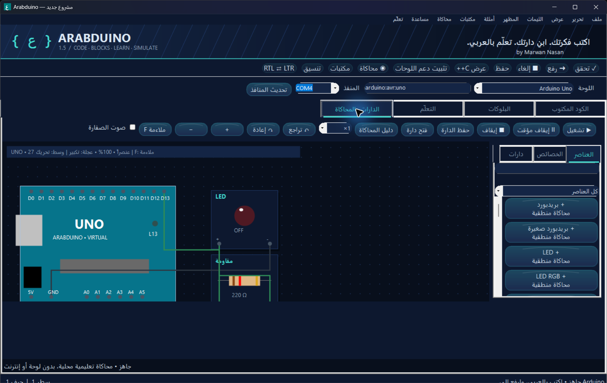

# Arabduino | برمجة الأردوينو بالعربية

**Arabduino** تطبيق تعليمي مجاني لنظام Windows لكتابة برامج Arduino باللغة العربية. طوّره **مروان نعسان (Marwan Nasan)**.

المشروع **مفتوح المصدر**؛ يمكنك استخدام الشفرة وتعديلها والمساهمة في تطويرها وفق التراخيص الموضحة أدناه.

## لقطات من التطبيق

### محرر الكود العربي

### البرمجة بالبلوكات

### محاكي الدارات

## ما هو Arabduino؟

يتيح لك البرنامج كتابة بنية وأوامر Arduino بكلمات عربية، ثم يحولها إلى C++ متوافق مع Arduino. يحتفظ المشروع بكتابته العربية، ويمكن تصديره إلى ملف .ino للتجميع والرفع إلى اللوحة.

يتضمن التطبيق:

- محرراً عربياً باتجاه الكتابة من اليمين إلى اليسار أو من اليسار إلى اليمين، مع تلوين الكود وتنسيقه.
- ترجمة أسماء الأوامر والأنواع والكلمات المحجوزة العربية إلى C++، مع قبول الأوامر الإنجليزية أيضاً.
- بناء البرامج بالبلوكات، بما فيها الشروط والحلقات والمتغيرات والتعابير.
- مرجعاً تعليمياً عربياً قابلاً للبحث وأمثلة جاهزة.
- محاكاة تعليمية منطقية لبعض الدارات والعناصر الإلكترونية.
- التحقق والتجميع والرفع إلى اللوحة عبر Arduino CLI الرسمي.

## مثال: وميض المصباح المدمج

    فارغ إعداد() {
        نمط_المنفذ(المصباح_المدمج، خرج)؛
    }

    فارغ تكرار() {
        إشارة_رقمية(المصباح_المدمج، مرتفع)؛
        انتظار(1000)؛
        إشارة_رقمية(المصباح_المدمج، منخفض)؛
        انتظار(1000)؛
    }

يحوّل Arabduino هذا المثال إلى Arduino C++ عادي، مثل void setup() وpinMode وdigitalWrite وdelay.

## تشغيل البرنامج

- النظام: Windows 10 أو 11، إصدار 64 بت.
- يتطلب .NET Framework 4.8.
- [تنزيل نسخة التثبيت Arabduino Setup 1.5.0](https://github.com/Marwan-Naasan/Arabduino/releases/download/v1.5.0/Arabduino-Setup-1.5.0.exe) أو زيارة [صفحة الإصدارات](https://github.com/Marwan-Naasan/Arabduino/releases).
- لتجميع الشفرة، افتح PowerShell في مجلد المصدر وشغّل build.ps1. يحتاج التجميع إلى مترجم C# المرفق مع .NET Framework. يجلب البرنامج النصي Arduino CLI 1.5.1 الرسمي ويتحقق من SHA-256 قبل استخدامه.

## محتويات المستودع

- ملفات C# الخاصة بالتطبيق والمترجم والمحرر والبلوكات والمحاكاة.
- أمثلة Arduino بصيغتي .arabduino و.ino.
- أمثلة البلوكات وبيانات المرجع التعليمي ووثائق المصادر والتحقق.
- سكربتات بناء التطبيق وتوليد الأسماء البديلة.

## حدود المحاكاة

المحاكاة أداة تعليمية محدودة؛ فهي ليست محاكي AVR أو SPICE، ولا تحسب التيار أو الجهد أو السلوك الكهربائي الكامل. لا تستبدل اختبار الدارة الحقيقية أو اتباع إرشادات السلامة الكهربائية. راجع README.txt وVERIFICATION.txt للتفاصيل والميزات التي لم تُختبر على لوحة فعلية.

## الترخيص ونسب المصادر

- شفرة التطبيق: MIT، وفق LICENSE.txt.
- المادة التعليمية العربية المكيّفة من مرجع Arduino: CC BY-SA 3.0، مع نسبها وفق ArduinoReference-CC-BY-SA-3.0.txt وRESEARCH.md.
- Arduino CLI مكوّن مستقل غير معدّل، مرخص بموجب GPL-3.0؛ [مصدره الرسمي](https://github.com/arduino/arduino-cli/tree/v1.5.1).
- Arabduino مشروع مستقل وغير تابع لـArduino أوWokwi.

## المؤلف

**مروان نعسان — Marwan Nasan**. المساهمات والتعديلات مرحب بها؛ يُرجى الحفاظ على إشعارات حقوق النشر ونسب المصادر والتراخيص الخاصة بكل جزء.
